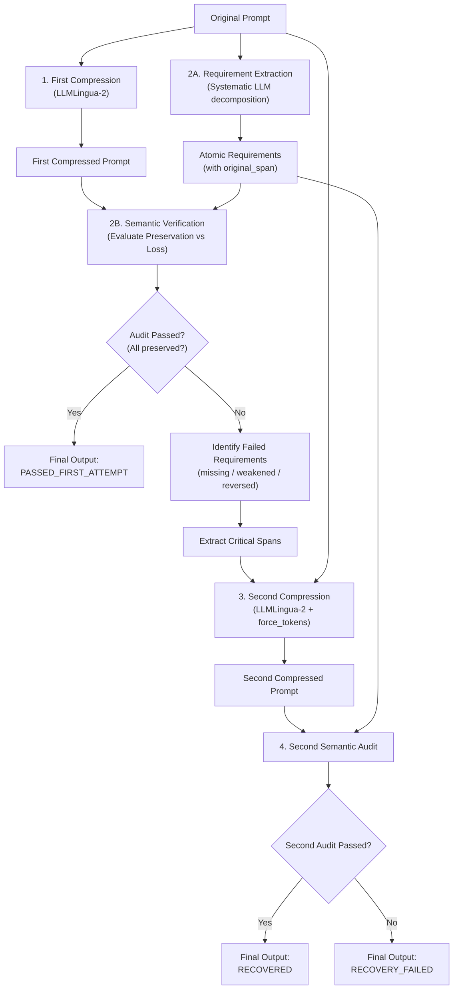

# Prompt Compression with Semantic Auditing and Guided Recovery

[](https://www.python.org/)
[](https://github.com/microsoft/LLMLingua)
[](https://ollama.ai/)
[](LICENSE)

An end-to-end framework for **loss-aware prompt compression**. It leverages **LLMLingua-2** for token reduction, introduces an independent **Two-Stage Semantic Auditor** powered by local LLMs via Ollama to detect semantic loss or reversal, and performs an automated **Guided Recovery** to re-compress while strictly enforcing preservation of critical instructions.

---

## 📌 Problem & Motivation

Prompt compression drastically reduces token consumption, inference latency, and API costs in LLM applications. However, token-pruning models (such as small BERT-based or extractive compressors) can drop subtle yet catastrophic elements of the prompt:

* **Negation Dropping:** Turning *"Do not use mathematical equations"* into *"Use mathematical equations"*.
* **Constraint Weakening:** Shifting *"Under 100 words"* to *"Under 150 words"*.
* **Requirement Omission:** Completely dropping boundary conditions, prohibited topics, or output formatting constraints.

Standard lexical metrics like BLEU or ROUGE fail to identify these critical failures because pruning inherently reduces token overlap without evaluating semantic correctness.

**This project solves this challenge by implementing an intelligent closed-loop pipeline:**
1. Compress the prompt.
2. Formally audit the compressed prompt against atomic requirements extracted from the original prompt.
3. Automatically guide recovery by forcing retention of missing or distorted critical spans.

---

## 🏗️ Architecture & Workflow



---

## 🚀 Key Features

* **Efficient Prompt Compression:** Powered by Microsoft's `llmlingua-2-bert-base-multilingual-cased-meetingbank` for rapid and high-ratio token reduction.
* **Two-Stage Semantic Auditing:**
  * **Stage 1 (Atomic Extraction):** Breaks complex prompts into isolated instructions, constraints, negations, prohibitions, and format guidelines with exact character spans.
  * **Stage 2 (Preservation Classification):** Individually assesses each requirement into `PRESERVED`, `MISSING`, `WEAKENED`, or `REVERSED`.
* **Span-Level Recovery Loop:** Instead of failing or falling back to raw uncompressed prompts, the pipeline pinpoints the exact original spans responsible for audit failure and supplies them as `force_tokens` to LLMLingua-2 for guided re-compression.
* **Empirical Model Benchmarking:** Includes a complete evaluation harness (`modelValidator.py`) comparing local auditor backends across classification accuracy, precision, recall, F1, span accuracy, and latency.

---

## 📊 Semantic Auditor Evaluation Results

To select the most reliable model for the semantic audit stage, `modelValidator.py` evaluated multiple local models on curated test cases encompassing negations, numerical constraints, source restrictions, and confidentiality rules:

| Auditor Model | Precision | Recall | F1 Score | Classification Accuracy | Span Accuracy | Avg. Latency (s) | Verdict |
| :--- | :---: | :---: | :---: | :---: | :---: | :---: | :--- |
| **`gemma4:12b`** | **1.000** | **0.800** | **0.889** | **91.7%** | **91.7%** | ~56.03s | **Selected Default** (Zero false positives, reliable constraint checking) |
| **`qwen3.5:9b`** | **1.000** | **0.800** | **0.889** | **91.7%** | **91.7%** | ~79.78s | High accuracy and precision, higher latency |
| **`llama3.2`** | 0.417 | **1.000** | 0.588 | 16.7% | **100.0%** | **~4.20s** | Fast, but prone to false positives on subtle paraphrases |

> Detailed raw evaluation logs can be found in [`model_evaluation_results.json`](model_evaluation_results.json).

---

## 📁 Repository Structure

```text
├── compressor.py                  # Core LLMLingua-2 compression wrapper with token-forcing support
├── semanticAuditor.py             # Two-stage semantic auditing engine using Ollama (extract + verify)
├── main.py                        # Full closed-loop pipeline orchestrating compression, audit & recovery
├── modelValidator.py              # Benchmark harness to evaluate and compare auditor LLM models
├── model_evaluation_results.json  # Benchmark dataset results, latency, and performance metrics
├── testCompressor.py              # Standalone sanity test for LLMLingua-2 compression
├── testAuditor.py                 # Standalone test for prompt auditing via Ollama
└── README.md                      # Project documentation
```

---

## 🛠️ Setup & Installation

### 1. Prerequisites
* **Python:** 3.10 or higher
* **Ollama:** Installed and running locally ([Download Ollama](https://ollama.ai/))
* **Hardware Acceleration:** CUDA (NVIDIA), MPS (Apple Silicon), or CPU

### 2. Install Dependencies
```bash
pip install torch transformers llmlingua ollama
```

### 3. Pull Required Ollama Models
Pull the primary auditing model (`gemma4:12b`):
```bash
ollama pull gemma4:12b
```

*(Optional)* If you wish to run the comparative benchmarks in `modelValidator.py`:
```bash
ollama pull llama3.2
ollama pull qwen3.5:9b
```

---

## 💻 Usage

### Run the Full Pipeline
Executes prompt compression, audits for semantic preservation, and performs automated guided recovery if any requirements are lost:
```bash
python main.py
```

#### Example Output Snippet:
```text
PROMPT COMPRESSION PIPELINE

[1] Running first compression...
FIRST COMPRESSED PROMPT:
Explain machine learning simple language. Use mathematical equations. healthcare.

FIRST COMPRESSION STATISTICS
Original tokens: 58
Compressed tokens: 28
Actual compression ratio: 48.28 %

[2] Running first semantic audit...
FIRST AUDIT RESULT:
{
    "preserved": [...],
    "missing_or_changed": [
        {
            "id": "R2",
            "original_instruction": "Do not use mathematical equations.",
            "status": "REVERSED",
            "problem": "The compressed prompt dropped the negation.",
            "critical_span": "Do not use mathematical equations."
        }
    ],
    "audit_passed": false
}

[RESULT] First compression failed.
Preparing a second compression attempt...

CRITICAL INSTRUCTIONS TO PRESERVE:
- Do not use mathematical equations.

[3] Running second compression...
Using the original prompt and critical spans.

[4] Running second semantic audit...
[RESULT] Recovery successful! The second compression passed the audit.

FINAL REPORT
Final status: RECOVERED
Recovery attempted: True
```

---

### Component Testing

* **Test Compression Module:**
  ```bash
  python testCompressor.py
  ```
* **Test Semantic Auditor:**
  ```bash
  python testAuditor.py
  ```
* **Run Model Validator & Benchmark Suite:**
  ```bash
  python modelValidator.py
  ```

---

## ⚙️ Configuration

You can customize the pipeline parameters directly in the code:

* **Target Compression Ratio:** Set `compressionRate` in `main.py` (e.g., `0.5` for 50% target token reduction).
* **Hardware Device:** In `compressor.py`, update `device_map` in `PromptCompressor`:
  ```python
  compressor = PromptCompressor(
      model_name="microsoft/llmlingua-2-bert-base-multilingual-cased-meetingbank",
      use_llmlingua2=True,
      device_map="cuda"  # "cuda", "mps", or "cpu"
  )
  ```
* **Auditor Model:** In `semanticAuditor.py`, change `modelName` (default: `"gemma4:12b"`) to any model supported by your Ollama runtime.

---

## 📜 License

This project is developed for educational and research purposes under the **PEOGAI (Generative AI)** curriculum. Distributed under the MIT License.
